# QCon Collector: architecture

Status: design for review, 2026-11-10. Fly out Nov 14. Conference Nov 16–18, training Nov 19–20.
Companion files: `design-spec.md` (screen-by-screen UI spec), `research-qcon-logistics.md` and `research-ios-feasibility.md` (sources for the facts cited here as [L§n] and [F§x]).

## 1. Summary

A small offline iOS app (the Collector) records what happens in each talk as a folder of plain files: slide photos, one-tap moment markers, typed notes, and voice reflections recorded between talks. After the trip, Claude Code turns those folders into a sourced brief per talk, a set of cross-talk themes, and a knowledge repo for the teams. When QCon releases its recordings on Dec 21, a last pass converts every moment marker into a timestamp in the official video.

Five decisions shape everything else:

1. **Session audio is off by default.** QCon's terms allow still photos and forbid making "your own video of any session", with expulsion as the sanction; audio is not mentioned [L§4]. The system is complete without session audio. A per-talk switch exists for when a speaker or QCon staff says yes, and it records who said yes.
2. **Moment markers are the audio strategy.** Each marker stores its offset from talk start. QCon publishes most recordings on Dec 21, streaming only, for 12 months [L§2]. Markers become an index into those recordings. The "100% audio" goal is met by the official recording plus a precise list of where to listen, not by a private copy.
3. **The app only collects.** No network calls, no accounts, no transcription, no OCR. Every capture is a file on disk within a second of the tap. Understanding happens later on the PC.
4. **The bundle format is the contract.** The app, the no-app fallback and the PC pipeline all meet at one folder layout. The format is frozen on evening 1; the Claude-side pipeline can be built after the trip.
5. **Two zones, one gate.** A private vault holds raw captures, audio, and anything from hallway or unconference sessions. A separate shareable repo is generated from it through a publish gate that Matt approves talk by talk.

## 2. What QCon already provides, and what this system therefore skips

| QCon provides | Consequence |
|---|---|
| Schedule, starred agenda and session ratings in the InfoQ Mobile app [L§5] | The Collector does not rate talks or rebuild the agenda. It carries a read-only copy of the schedule so it can name the current talk. |
| Stable talk URLs (`qconsf.com/presentation/nov2026/{slug}`, `/keynote/nov2026/{slug}`) and a program file at `qconsf.com/llms/nov2026.md` [L§3, L§5] | The URL slug is the talk ID everywhere. |
| Recordings of "a majority" of sessions from Dec 21, streaming only, no download, no subtitles [L§2] | No session recording by default. The repo links to videos and never stores them. Talks tagged "No Video Available" are flagged so Matt captures them more heavily. |
| Slides only if the speaker agrees, "within days"; past pages showed none publicly [L§3] | Matt's photos are the slide record. A later check looks for official decks. |
| InfoQ news write-ups within about a week; public video and transcript 9–11 months later [L§2] | Enrichment searches InfoQ. A long-running watch picks up transcripts when they appear. |
| A Code of Conduct that keeps peer-sharing content private [L§4] | Unconference, lunch-table and hallway captures are private by default and cannot be published. |

One correction to the research: the `llms/nov2026.md` file lists tracks and hosts but, when fetched on Nov 10, carried no session-level times or rooms. The schedule dataset was therefore built from the schedule, track, speaker and presentation pages (section 4.8).

## 3. End-to-end flow

```mermaid
%%{init: {"theme": "base", "themeVariables": {"fontFamily": "Segoe UI, Arial, sans-serif", "primaryColor": "#FFFFFF", "primaryTextColor": "#000000", "primaryBorderColor": "#1857B8", "lineColor": "#5F6877", "clusterBkg": "#F2F3F5", "clusterBorder": "#9AA2AE"}}}%%
flowchart LR
  subgraph EVENT["At QCon, Nov 16-20"]
    direction TB
    A1["iPhone Collector<br/>slides, moments, notes"]
    A2["iPad Collector<br/>notes, moments"]
    A3["Between talks<br/>voice reflection"]
    A4["Evening export<br/>zip per day to OneDrive"]
    A1 --> A4
    A2 --> A4
    A3 --> A4
  end
  subgraph VAULT["Private vault on the PC"]
    direction TB
    B1["Ingest<br/>validate, merge devices"]
    B2["Read<br/>slides and notes to text"]
    B3["Enrich<br/>speaker, company, repos, docs"]
    B4["Synthesize<br/>brief per talk, themes"]
    B5["Check<br/>every claim has a source"]
    B1 --> B2 --> B3 --> B4 --> B5
  end
  subgraph SHARE["Shareable knowledge repo"]
    direction TB
    C1{{"Publish gate<br/>Matt approves each talk"}}
    C2["kb repo<br/>briefs, themes, actions"]
    C1 --> C2
  end
  D1["Dec 21: official videos<br/>streaming only"]
  D2["Reconcile<br/>moments to video timestamps"]
  A4 --> B1
  B5 --> C1
  D1 --> D2
  B1 -. "moment offsets" .-> D2
  D2 --> C2
  classDef blue fill:#1857B8,stroke:#0C0D0F,color:#FFFFFF;
  classDef white fill:#FFFFFF,stroke:#1857B8,color:#000000;
  classDef gray fill:#E6E8EC,stroke:#5F6877,color:#000000;
  classDef black fill:#0C0D0F,stroke:#0C0D0F,color:#FFFFFF;
  class A1,A2,A3,A4 white;
  class B1,B2,B3,B4,B5 gray;
  class C1 black;
  class C2,D2 blue;
  class D1 white;
```



| Stage | When | Who does it | Output |
|---|---|---|---|
| Capture | During each talk, and the 20–25 minute breaks | Matt, Collector app | One session bundle per talk per device |
| Export | Each evening at the hotel | Matt, share sheet | `collector_<date>_<device>.zip` in OneDrive |
| Ingest | After return (or nightly if the PC travels) | `tools/ingest.py` via `/qcon-ingest` | `vault/talks/<talk_id>/timeline.jsonl` and media |
| Read | After ingest | `slide-reader` subagent | `slides.md`, `notes.md` |
| Enrich | After read | `speaker-researcher`, `repo-inspector` | `research/` with cached sources |
| Synthesize | After enrich | `brief-writer` | `brief.md`, then themes and trip summary |
| Check | Before publish | `claim-checker` | A pass/fail report per brief |
| Publish | When Matt marks a brief reviewed | `/qcon-publish` and `tools/publish_gate.py` | Commit to the `kb` repo |
| Reconcile | From Dec 21 | Matt with `/qcon-reconcile` | Watch list with video timestamps |

## 4. The Collector app

### 4.1 Principles

- **A capture is one tap and one file.** Every action appends a line to `events.jsonl` and flushes before the UI confirms. Nothing lives only in memory.
- **No network.** The app makes no requests. "Offline" is the normal state, not an error state. The only outbound paths are the share sheet, the Files app and USB.
- **The talk is always known.** Captures can only happen inside a session, and a session always has a talk ID (from the schedule, or an ad hoc one).
- **Policy is built into the screens.** Voice recording is offered before and after a talk, not during it. Session audio needs a recorded grant each time.
- **Native SwiftUI components only**, so it can be finished in three evenings.

### 4.2 Screens and behaviours

Three tabs and one full-screen cover. Detail is in `design-spec.md`.

| Screen | Job | Key behaviour |
|---|---|---|
| **Now** (tab) | Start capturing the right talk in one tap | Suggests the talk for the current slot: a starred talk in this slot first, then the talk in the room Matt was last in (tracks stay in one room for the day), then the rest of the slot. Between talks it offers "Reflect" on the talk that just ended. Also starts an ad hoc private session. |
| **Capture** (full-screen cover) | Slide photo, moment marker, note, talk timer | Live camera with zoom presets; Slide and Moment are the two large thumb targets; Note opens a half sheet. Timer shows minutes since the speaker started and minutes left. "Sync start" sets the true start time. Dim appearance by default. |
| **Talks** (tab) | Browse the schedule, star talks for the plan, open any talk | Day picker, sections per time slot, capture counts on talks already captured. |
| **Talk review** (pushed from Talks or Now) | See and fix what was captured | Timeline with talk-relative offsets; edit or delete an item; play a reflection; resume capture; add a reflection. |
| **Export** (tab) | Get bundles off the device and show device health | Share a day as a zip; shows what has not been exported, free space, and when the app's 7-day signature expires. Holds the two settings. |

Behaviours that matter:

- **Talk timer and offsets.** Clock zero (`t0`) is the scheduled start. Tapping "Sync start" when the speaker begins writes a `speaker_start` event. Every event stores its offset from `t0`; talk-relative time is that offset minus the `speaker_start` offset, computed on display and at ingest. If Matt never taps it, the scheduled start is used and the brief says so.
- **Moment.** One tap writes the event and gives a haptic. For five seconds a row of four tags is offered (Idea, For us, Follow up, Question). Tagging is optional and appends a second event; it never delays the first.
- **Note.** The note is stamped with the time the sheet opened, which is when the thought happened, not when typing finished.
- **Reflection.** A voice note in Matt's own words, recorded after the talk ends (or before it starts), with three prompts on screen: what was the claim, what would we do with it, who should hear it. This is the main audio input and needs no permission from anyone.
- **Session audio (optional build, off by default).** Hidden unless enabled in Export. Starting it requires a grant record: who (speaker or QCon staff), how (in person or in writing), optional note. The grant is written to the timeline and the manifest. A persistent indicator shows while recording. Recording follows the research design: `AVAudioEngine` tap, AAC mono 64 kbps, 5-minute segments, a new segment after any interruption, started in the foreground only [F§C].
- **Ending.** "End" closes the session and shows Talk review with the Reflect prompt. Starting another session closes the open one. Sessions are never closed silently by a timer.
- **Recovery.** On launch, an open session whose scheduled end plus 15 minutes has not passed reopens straight into Capture. Otherwise it is marked closed with `close_reason: "recovered"`.
- **Privacy default.** Sessions of kind `unconference`, `social` or `adhoc` get `visibility: "private"`. Matt can change it per session in Talk review; the publish gate still requires his explicit review.

### 4.3 On-device data model

Swift types the builder should implement (Codable, snake_case keys in JSON):

```
Schedule      { schema, event, tz, generated_utc, source, talks: [Talk] }
Talk          { talk_id, kind, title, speakers: [Speaker], track?, room?, start, end, url?, no_video, private_by_default }
Speaker       { name, company?, role?, speaker_url? }
TalkKind      keynote | presentation | unconference | sponsored | training | social | adhoc
Manifest      (section 4.5)
Event         (section 4.6)
CollectorState{ schema, device_label, plan: [talk_id], settings: { dim_capture, offer_session_audio },
                last_room?, open_bundle?, exports: [ExportRecord] }
ExportRecord  { date, exported_utc, last_seq_by_bundle: { bundle_id: Int }, bytes }
```

There is no database. State is the files in `Documents/`. `collector.json` holds the small amount of app state and is rewritten atomically (write to a temporary file, then rename).

### 4.4 Session bundle: folder layout and naming

```
Documents/
  collector.json                       app state (plan, settings, export log)
  schedule.json                        optional override; if present it replaces the bundled schedule
  sessions/
    2026-11-16/                        conference-local date (America/Los_Angeles)
      0900_harness-new-operating-system__iphone/
        manifest.json                  header, rewritten atomically at open, sync, close
        events.jsonl                   append-only timeline, one JSON object per line
        photos/0007_photo_170712Z.jpg
        voice/0021_voice_181412Z.m4a
        audio/0003_audio_seg001_170301Z.m4a      only when session audio was granted
```

Rules:

- **Bundle folder**: `<HHMM>_<slug>__<device>`. `HHMM` is the scheduled start in conference-local time (the open time for ad hoc sessions). `slug` is the talk ID cut to 48 characters, because Windows paths are limited and QCon slugs run to 82 characters in this year's schedule. The full ID is in the manifest. `device` is the device label, `iphone` or `ipad`.
- **Bundle ID**: `<date>_<folder name>`, for example `2026-11-16_0900_harness-new-operating-system__iphone`.
- **Media files**: `<seq4>_<type>_<HHMMSS>Z.<ext>`. `seq4` is the event sequence number, zero-padded; the time is UTC. Offsets are deliberately not in file names, because the talk-relative offset changes if "Sync start" is tapped later.
- **Photos** are JPEG, 12 MP maximum, quality about 0.8. JPEG rather than HEIC so that the PC tools and Claude read them without conversion. This is a judgment call; storage is roughly 2 MB per photo (estimate, to be measured in the dress rehearsal).
- **One bundle per talk per device.** Reopening a talk on the same device appends to the same bundle with a `resume` event.

### 4.5 `manifest.json`

```json
{
  "schema": "collector.bundle/1",
  "bundle_id": "2026-11-16_0900_harness-new-operating-system__iphone",
  "talk": {
    "talk_id": "harness-new-operating-system",
    "kind": "keynote",
    "title": "The Harness Is the New Operating System",
    "speakers": [{ "name": "Manju Rajashekhar", "company": "Mad Labs" }],
    "track": null,
    "room": "Grand Ballroom",
    "url": "https://qconsf.com/keynote/nov2026/harness-new-operating-system",
    "sched_start_utc": "2026-11-16T17:00:00Z",
    "sched_end_utc": "2026-11-16T18:10:00Z",
    "tz": "America/Los_Angeles",
    "no_video": false
  },
  "visibility": "shareable",
  "device": { "label": "iphone", "model": "iPhone17,1", "os": "26.1", "app_version": "1.0 (3)" },
  "clock": {
    "t0_utc": "2026-11-16T17:00:00Z",
    "t0_basis": "scheduled_start",
    "speaker_start_utc": "2026-11-16T17:03:00.120Z",
    "speaker_start_t_ms": 180120
  },
  "session_audio": { "permitted": false, "granted_by": null, "how": null, "note": null, "granted_utc": null },
  "opened_utc": "2026-11-16T16:57:41.002Z",
  "closed_utc": "2026-11-16T18:11:30.550Z",
  "close_reason": "user",
  "counts": { "photo": 14, "moment": 6, "note": 2, "voice": 1, "audio_segment": 0 },
  "last_seq": 24
}
```

Field notes: `visibility` is `shareable` or `private`. `t0_basis` is `scheduled_start`, or `opened` for ad hoc sessions. `granted_by` is `speaker` or `organizer`; `how` is `in_person` or `written`. `close_reason` is `user`, `superseded` or `recovered`. The manifest is a convenience header. If it and `events.jsonl` disagree, `events.jsonl` wins and ingest rebuilds the counts.

### 4.6 `events.jsonl`

Common fields on every line:

| Field | Type | Meaning |
|---|---|---|
| `seq` | int | 1-based, strictly increasing within the bundle |
| `id` | string | `<device>-<seq4>`, unique across devices, for example `iphone-0007` |
| `type` | string | See the table below |
| `ts_utc` | string | ISO 8601 UTC with milliseconds; wall-clock time of the action |
| `t_ms` | int | `ts_utc − t0_utc` in milliseconds; negative before the scheduled start |
| `mono_ms` | int | Milliseconds on a monotonic clock that keeps counting during sleep, since the bundle was opened; lets ingest detect a wall-clock jump |

Event types and their extra fields:

| `type` | Extra fields | Notes |
|---|---|---|
| `session_open` | `app_version` | First line |
| `resume` | | Session reopened |
| `speaker_start` | | The last one in the file wins |
| `photo` | `file`, `zoom` | |
| `moment` | `tag?` | `tag` is `idea`, `for_us`, `follow_up` or `question` |
| `note` | `text`, `saved_utc` | `ts_utc` is when the sheet opened |
| `voice` | `file`, `dur_ms`, `phase` | `phase` is `before` or `after`; a reflection |
| `tag` | `target`, `tag` | Adds or changes a moment's tag |
| `edit` | `target`, `text` | Replaces a note's text |
| `delete` | `target` | Tombstone; the media file is kept on the device and dropped at ingest |
| `audio_permission` | `granted_by`, `how`, `note?` | Required before any `audio_start` |
| `audio_start`, `audio_segment`, `audio_gap`, `audio_stop` | `file?`, `dur_ms?`, `reason?` | One `audio_segment` per closed 5-minute file |
| `visibility` | `value` | `shareable` or `private`; set from Talk review, mirrored into the manifest |
| `session_close` | `reason` | |

Any event may also carry `clock_jump_ms` when the wall clock was found to have moved against the monotonic clock by more than 5 seconds since the previous event.

Example lines (same talk as the manifest; the speaker started at 09:03, so the photo at `t_ms` 432000 is 4 min 12 s into the talk):

```json
{"seq":1,"id":"iphone-0001","type":"session_open","ts_utc":"2026-11-16T16:57:41.002Z","t_ms":-138998,"mono_ms":0,"app_version":"1.0 (3)"}
{"seq":2,"id":"iphone-0002","type":"speaker_start","ts_utc":"2026-11-16T17:03:00.120Z","t_ms":180120,"mono_ms":319118}
{"seq":7,"id":"iphone-0007","type":"photo","ts_utc":"2026-11-16T17:07:12.380Z","t_ms":432380,"mono_ms":571378,"file":"photos/0007_photo_170712Z.jpg","zoom":2.0}
{"seq":11,"id":"iphone-0011","type":"moment","ts_utc":"2026-11-16T17:14:40.010Z","t_ms":880010,"mono_ms":1019008}
{"seq":12,"id":"iphone-0012","type":"tag","ts_utc":"2026-11-16T17:14:42.700Z","t_ms":882700,"mono_ms":1021698,"target":"iphone-0011","tag":"idea"}
{"seq":13,"id":"iphone-0013","type":"note","ts_utc":"2026-11-16T17:15:05.200Z","t_ms":905200,"mono_ms":1044198,"text":"Check this against our harness architecture doc.","saved_utc":"2026-11-16T17:15:31.900Z"}
{"seq":21,"id":"iphone-0021","type":"voice","ts_utc":"2026-11-16T18:14:12.000Z","t_ms":4452000,"mono_ms":4590998,"file":"voice/0021_voice_181412Z.m4a","dur_ms":84000,"phase":"after"}
```

The append-only log is the reason the format survives crashes: a kill mid-talk loses at most the line being written, and a truncated last line is discarded at ingest.

### 4.7 How iPhone and iPad captures merge

Both devices load the same schedule, so both bundles carry the same `talk_id`. Ingest groups bundles by `talk_id`, concatenates their events and sorts by `ts_utc`. IDs stay unique because they carry the device label. Both devices set their clocks from the network, typically within about a second [F§F, inference], which is finer than anything a slide photo or a note needs. If both devices have a `speaker_start` within 10 seconds of each other, ingest reports the difference as measured skew and uses the earlier one; it does not rewrite timestamps. The iPhone is the camera and marker device; the iPad is the note device (see `design-spec.md`).

### 4.8 Schedule input

The Collector reads a schedule in its own small contract, `collector.schedule/1`:

```json
{
  "schema": "collector.schedule/1",
  "event": "qconsf-nov2026",
  "tz": "America/Los_Angeles",
  "generated_utc": "2026-11-13T23:10:00Z",
  "source": "https://qconsf.com/schedule/nov2026",
  "talks": [
    {
      "talk_id": "harness-new-operating-system",
      "kind": "keynote",
      "title": "The Harness Is the New Operating System",
      "speakers": [{ "name": "Manju Rajashekhar", "company": "Mad Labs", "role": "Founder & CEO", "speaker_url": "https://qconsf.com/speakers/manjurajashekhar" }],
      "track": null,
      "room": "Grand Ballroom",
      "start": "2026-11-16T09:00:00-08:00",
      "end": "2026-11-16T10:10:00-08:00",
      "url": "https://qconsf.com/keynote/nov2026/harness-new-operating-system",
      "no_video": false,
      "private_by_default": false
    }
  ]
}
```

`tools/build_schedule.py` builds this file from `qconsf-2026-schedule.json` (119 sessions, 127 speakers, 18 tracks, retrieved Nov 10; see `qconsf-2026-schedule-notes.md` for gaps). The mapping:

| Collector field | From the dataset |
|---|---|
| `talk_id` | `sessions[].id` (the URL slug) |
| `kind` | `keynote` → `keynote`; `training` → `training`; `talk` → `sponsored` when `track_id` starts with `sponsored-solution-track`, otherwise `presentation`; `other` → `unconference` when the id starts with `unconference-`, otherwise `sponsored` |
| `start`, `end` | `day` plus `start` / `end` (local `HH:MM`) in `event.timezone`, written with the UTC offset. End times in the dataset are derived from published durations. |
| `speakers` | `speaker_ids` joined to `speakers[]`: `name`, `company`, `title` → `role`, `profile_url` → `speaker_url` |
| `track` | `track_id` joined to `tracks[].name` |
| `room` | `room`; null for the Tue and Wed keynotes, which the site does not yet list |
| `no_video` | true when `video_expected` is false (33 sessions). The dataset's notes call this field indicative, so the app words it as a prompt to capture more, not as a fact. |
| `private_by_default` | true for `unconference` |

The adapter fails loudly on a session with no start time or no id. Sessions with no speaker yet (nine sponsored placeholders and one Monday 17:05 talk) are kept and shown as "Speaker to be announced". The site says the schedule is subject to change, so the dataset is rebuilt on evening 3 and the result is bundled through `resources:` in `xtool.yml` [F§A]. A newer copy dropped into the app's folder through Files replaces the bundled one, which covers room changes on site without a rebuild.

Up to six sessions run in parallel in a slot (four curated tracks and two sponsored), plus an unconference in some slots. The dataset's abstracts and bios are paraphrased summaries, not quotations, so briefs never quote them; enrichment fetches the talk page itself. Its `speakers[].links` (GitHub, LinkedIn, X, website) are the starting points for speaker research.

## 5. Ingest

**Off the device** [F§F]:

1. Each evening: Export tab, "Share <day> as .zip", save to OneDrive. This is the off-device backup and the main path.
2. At home: Apple Devices app over USB for a full copy. Detach the device from WSL (`usbipd`) first or Windows cannot see it.
3. The Files app shows the same folders under On My iPhone › Collector. It needs two Info.plist keys and no code.

**On the PC**, `tools/ingest.py` (plain Python, no model calls) does the deterministic work:

- Unzips into `vault/raw/<date>/<bundle>/` and never modifies it afterwards.
- Validates each bundle against the schemas; drops a truncated last line; applies `tag`, `edit` and `delete` events; rebuilds counts.
- Groups bundles by `talk_id`, merges devices, writes `vault/talks/<talk_id>/timeline.jsonl` with one added field, `talk_ms` (offset from the speaker's start).
- Copies photos to `photos/S01.jpg…` in time order and marks near-duplicates (perceptual hash) so the reader skips them.
- Transcribes voice reflections locally with faster-whisper. This differs from the research, which recommends WhisperX [F§H]: reflections are one speaker, so diarization and its Hugging Face token are unnecessary. WhisperX is used only for session audio recorded with permission.
- Is idempotent: re-running on a later, fuller export of the same day updates the talk folders.

Nothing is sent to a cloud transcription service. The research flags that as a possible conflict with both QCon's terms and your employer's data handling [F§H].

## 6. Enrichment

Per talk, Claude researches four things and writes them under `vault/talks/<talk_id>/research/`.

| Subject | What is collected | Where from, in order of trust |
|---|---|---|
| The talk | Abstract, key takeaways, track, host, tags, official slides if posted, "No Video" tag | The presentation page and schedule on qconsf.com [L§6] |
| The speaker | Role, employer, prior talks and writing, GitHub account | QCon speaker page; the speaker's own site and GitHub; InfoQ profile and articles (not linked from QCon pages, so searched separately [L§6]) |
| The company | What it sells or runs, and whether the talk's subject is its product | The company's own documentation and engineering blog; then independent coverage |
| Repos and docs | For each repo or tool shown on a slide or named in a note: owner, licence, last release, activity, what it does, whether it runs in our environment | The repository and its documentation, read directly; `gh` for metadata |

Rules:

- **Captures drive the search.** URLs, repo names and product names read off slide photos are the first queries. A speaker's whole back catalogue is not summarised; only what bears on this talk.
- **Everything fetched is cached.** `research/cache/<n>.md` holds the extracted text; `research/sources.yaml` holds one record per source: `id` (R1, R2…), `url`, `title`, `publisher`, `fetched_utc`, `tier` (1 primary, 2 InfoQ and comparable editorial, 3 other), and `vendor: true` when the publisher sells the thing described.
- **Vendor claims are labelled.** A performance or adoption number that comes only from the vendor is reported as the vendor's claim, never as a finding.
- **InfoQ write-ups** of selected talks appear during the event and the week after [L§2]. `/qcon-enrich` checks for one per talk and re-checks on later runs.

## 7. Synthesis

### 7.1 Citation discipline

Every statement in a brief is one of three kinds, and is marked as such:

| Mark | Meaning | Example |
|---|---|---|
| `[S07]`, `[N3]`, `[M4]`, `[V1]`, `[A 23:10]` | Captured at the talk: slide photo, note, moment, reflection, permitted audio | "The speaker showed a four-stage pipeline [S07]." |
| `[R2]` | A cached public source | "The project is Apache-2.0 licensed [R2]." |
| "Our read:" | Claude's inference or Matt's opinion | "Our read: this fits lanes with clean patterns, not legacy code." |

A sentence about what the speaker said must carry a capture mark. A fact about a speaker, company or repo must carry a source mark. `claim-checker` re-reads each cited photo, note or cached page and fails the brief on any citation that does not support its sentence. Where captures are thin, the brief says less; it does not fill the gap from the abstract and present that as the talk.

### 7.2 Per-talk brief template (`brief.md`)

```markdown
---
schema: qcon.brief/1
talk_id: harness-new-operating-system
title: The Harness Is the New Operating System
speakers: [{ name: Manju Rajashekhar, company: Mad Labs, role: Founder & CEO }]
event: QCon San Francisco 2026
date: 2026-11-16
kind: keynote
track: null
talk_url: https://qconsf.com/keynote/nov2026/harness-new-operating-system
official_video: { status: pending, url: null, video_offset_ms: null }
official_slides: null
capture: { photos: 14, moments: 6, notes: 2, reflections: 1, session_audio: none, devices: [iphone, ipad], start_synced: true }
confidence: medium
confidence_reason: Good slide coverage and a reflection; no audio, so spoken detail is missing.
lenses: [agent-harness, platform]
tags: []
visibility: shareable
status: draft            # draft | reviewed | published
reviewed_by: null
updated: 2026-11-22
---

## In one paragraph
What the talk argued and why it matters to us. Four sentences at most.

## Key ideas
1. Idea, in one or two sentences, with capture marks.
(three to six items)

## Evidence
- What the speaker showed: data, architecture, demo. With marks.
- What public sources confirm or contradict. With marks.
- What we could not verify.

## How we could use it
### <lens name>
- The move: what we would change or try.
- First step: the smallest experiment, who would run it, rough size (S, M, L).
- Needs: prerequisites and dependencies.
- Risk or reason it may not transfer.
(one block per lens that fits, three at most; "No clear fit" is an acceptable answer)

## Follow-ups
- People to contact, repos to try, questions left open.

## Watch list
Filled by the reconcile pass: video timestamps for each moment.

## Sources
R1 … with URL and fetch date. Slide photos referenced are in assets/.
```

`confidence` is `high`, `medium` or `low`, and is about how well the brief represents the talk, not about whether the speaker is right. `low` is automatic when there are fewer than five photos and no notes or reflection.

### 7.3 Lenses

`vault/lenses.yaml` describes each initiative once: an ID, a two-line description, the questions it is currently trying to answer, and what would count as useful. `templates/lenses.example.yaml` shows the shape; the real file stays in the private vault. The lens mapper is instructed that most talks fit zero to two lenses, that a forced fit is a defect, and that the `constraints` listed in the file (regulation, stack, tools in use) belong in "Risk or reason it may not transfer".

### 7.4 Cross-talk outputs

- **Themes** (`themes/<slug>.md`): an idea that appears in three or more talks, with where speakers agreed, where they disagreed, and what that means for one lens. Each claim cites briefs, not raw captures.
- **Actions** (`actions.md`): every "First step" from every brief in one table: action, lens, source talk, size, suggested owner, status. This is the page that turns a trip into work.
- **Trip summary** (`README.md` of the repo): one page. What we went to learn, the five things worth acting on, what was over-hyped, and where to start reading.

## 8. Knowledge repo

Two directories, deliberately separate. The vault never has a work remote. The `kb` directory is its own git repository and is written only by `/qcon-publish`.

```
qcon-sf-2026/
  inbox/                          zips as downloaded
  vault/                          PRIVATE
    raw/<date>/<bundle>/          bundles as exported, read-only
    schedule/                     schedule dataset and built schedule.json
    lenses.yaml
    talks/<talk_id>/
      timeline.jsonl
      photos/S01.jpg …            slides.md beside them (what each photo shows)
      notes.md                    typed notes and reflection transcripts
      voice/                      reflections and transcripts
      audio/                      permitted session audio and transcripts, never published
      research/sources.yaml, cache/, speaker.md, company.md, repos.md
      brief.md
      reconcile.md
    themes/  actions.md  trip-summary.md
  kb/                             SHAREABLE, separate .git
    README.md                     trip summary and how to read the repo
    actions.md
    talks/2026-11-16/<talk_id>.md
    themes/<slug>.md
    speakers/<name>.md            public facts only, with sources
    assets/slides/<talk_id>/S07.jpg     only photos a brief cites, downscaled
    SOURCES.md                    how claims are marked; link to QCon's video terms
  tools/                          ingest.py, build_schedule.py, transcribe.py, publish_gate.py
  .claude/skills/  .claude/agents/
```

**What may enter `kb`**, enforced by `tools/publish_gate.py`:

| Content | Shareable | Reason |
|---|---|---|
| Briefs, themes, actions, speaker pages built from public sources | Yes, once `status: reviewed` | Matt's own analysis |
| Slide photos cited by a brief, downscaled, credited to the speaker | Yes (default; see decision 3) | QCon permits attendees' still photos [L§4]; whole decks are not reproduced |
| Links to official videos and slides | Yes, as links | Videos are for ticket holders, streaming only [L§2]; the link is marked as needing a QCon login |
| Session audio, reflection audio, any audio transcript | Never | Raw audio stays private in all cases |
| Anything from `private` sessions (unconference, lunch tables, hallway) | Never, unless Matt rewrites it as his own unattributed takeaway | Code of Conduct [L§4] |
| Raw notes and `timeline.jsonl` | No | Unreviewed, and may contain private remarks |

The gate fails the publish if a file under `kb/` has an audio extension, has front matter with `visibility: private` or `status` other than `reviewed` or `published`, cites an `[A …]` mark, or references a talk whose bundles were all private.

**Getting it to the teams.** The `kb` repo is plain Markdown with front matter, so it reads well in GitHub's web view with no build step. The intended home is a repository inside your organization's GitHub, announced with the trip summary. How the repo crosses from the personal machine to the work environment is Matt's call (decision 2).

## 9. How Claude Code drives it

Skills live in `.claude/skills/`, subagents in `.claude/agents/`. Deterministic work is in scripts so that skills orchestrate rather than improvise.

| Skill | Contract |
|---|---|
| `/qcon-ingest [zip…]` | Runs `ingest.py` on new zips in `inbox/`; reports talks found, counts per talk, validation problems, clock skew. Changes nothing outside `vault/`. |
| `/qcon-read <talk_id\|all>` | For each talk, has `slide-reader` write `slides.md` (one entry per photo: text, diagram description, URLs and names seen) and assembles `notes.md`. |
| `/qcon-enrich <talk_id\|all>` | Runs `speaker-researcher` and `repo-inspector`; writes `research/` with cached sources. Re-runnable; fetches only what is missing or older than 14 days. |
| `/qcon-brief <talk_id\|all>` | Has `brief-writer` produce `brief.md` from `slides.md`, `notes.md`, `research/` and `lenses.yaml`, then runs `claim-checker`. Leaves `status: draft`. |
| `/qcon-themes` | Reads all briefs; writes `themes/`, `actions.md` and `trip-summary.md`. |
| `/qcon-publish <talk_id\|all-reviewed>` | Copies reviewed briefs and their cited assets into `kb/`, runs `publish_gate.py`, commits. Never pushes; Matt pushes. |
| `/qcon-reconcile <talk_id>` | After Dec 21: records the video URL and one alignment point, converts moments to video timestamps, updates the Watch list. |
| `/qcon-status` | One table: every talk and how far it is through the pipeline, plus which talks have no official video. |

| Subagent | Contract |
|---|---|
| `slide-reader` | Input: one talk's photos. Output: `slides.md`. Reads images only; makes no web requests; describes what is visible and flags unreadable photos. |
| `speaker-researcher` | Input: talk metadata and `slides.md`. Output: `speaker.md`, `company.md`, new records in `sources.yaml`. Every statement cites a cached source. |
| `repo-inspector` | Input: repo and tool names from slides and notes. Output: `repos.md` with licence, activity, maturity and fit notes, from the repo itself. |
| `brief-writer` | Input: everything in the talk folder plus `lenses.yaml`. Output: `brief.md` to the template. May not introduce a fact that is not in its inputs. |
| `claim-checker` | Input: `brief.md` and the talk folder. Output: a list of unsupported or mis-cited sentences. Has no write access to the brief. Runs with a fresh context so that it does not inherit the writer's assumptions. |

Talks are independent, so `/qcon-read`, `/qcon-enrich` and `/qcon-brief` fan out one subagent per talk. Themes run once, after Matt has reviewed the briefs.

## 10. Reconcile with the official video (from Dec 21)

What is known: recordings are viewed in a browser through the QCon account, Chrome recommended, no download, no subtitles other than Chrome's live captions [L§2]. Whether the player accepts a start time in the URL is not known. The pass is therefore designed to need nothing from the player.

1. `/qcon-status` lists talks with a recording and talks without.
2. For each talk, Matt opens the video, finds any one slide he photographed, and gives Claude the video time at which it appears. One point is enough: `video_offset_ms = video_time − talk_ms of that photo`.
3. `/qcon-reconcile` writes the Watch list into the brief: each moment and note as a video time (`23:10 Moment, For us`), with the nearest slide photo beside it.
4. Matt watches those segments, not the whole talk, and adds notes. `/qcon-brief` is re-run to fold them in, and confidence is raised where it is earned.
5. A quarterly check looks for the public InfoQ page of each talk. When one appears with a transcript [L§2], it is cached as a tier 2 source and quotations can then be cited publicly.

Not done: capturing or transcribing the stream. The terms describe the videos as for personal viewing with no downloading [L§2].

## 11. Build plan

Evenings are Wed Nov 11, Thu Nov 12 and Fri Nov 13, with a reinstall on Sat Nov 14 before leaving. Each evening ends at a gate.

| When | Work | Gate |
|---|---|---|
| **Evening 1** | First 90 minutes: xtool toolchain, an empty SwiftUI app installed on both devices [F§A]. Then: load schedule, Now screen with slot suggestion, Capture with Moment and Note writing `events.jsonl` and `manifest.json`, camera view with one-tap capture and zoom presets, Files exposure. | G1: a 10-minute fake talk on the iPhone produces a valid bundle visible in Files. If the app is not on a device by the end of the evening, stop and switch to the fallback (section 13). If the custom camera view is not working by the end, use `UIImagePickerController` and move on. |
| **Evening 2** | Talks tab with stars, Talk review with edit and delete, voice reflections, Export (zip through the share sheet, export log, expiry and free-space rows), crash recovery, iPad layout. Session audio only if all of that is done with an hour to spare; otherwise it is left out of the build and Voice Memos covers any talk where permission is given. | G2: both devices capture the same fake talk and the zip opens on the PC. This is the go or no-go point for using the app at all. |
| **Evening 3** | `build_schedule.py` and the final `schedule.json`; a minimal `ingest.py` that validates and merges, to prove the format; a full 50-minute dress rehearsal in a dim room with slides on a TV, both devices, phone locked between captures; fix the three worst problems; freeze. Set up the fallback Shortcut regardless. | G3: rehearsal bundle ingests cleanly; photos are legible; battery use is noted. |
| **Sat Nov 14, morning** | Run `xtool dev` to both devices; confirm with `xtool ds profiles list` that expiry is on or after Nov 21 [F§B]. Star the planned talks. Do not touch xtool sign-in again until home. | App opens on both devices. |
| **After the trip** | Build the skills and subagents in section 9; run the pipeline. First briefs to the teams about a week after return. | |

The Claude-side pipeline is not on the critical path before the flight. Only the bundle format is.

## 12. Risks, ranked

| # | Risk | Likelihood | Effect | Mitigation |
|---|---|---|---|---|
| 1 | Toolchain friction (WSL, USB passthrough, signing) consumes evening 1 [F§A] | Medium | No app | Gate G1; fallback is complete and rehearsed on evening 3 either way |
| 2 | Recording a session without permission | Low by design | Expulsion without refund [L§4]; reputational exposure for a corporate attendee | Audio off by default; grant record required; voice notes only before or after a talk |
| 3 | The 7-day free signature expires, or the signing certificate is revoked, mid-trip [F§B] | Low if the Nov 14 reinstall happens | App will not open; data remains on the device | Reinstall Nov 14; expiry shown in the Export tab; nightly export; never delete the app; never re-run xtool setup while away |
| 4 | Data lost before export (lost phone, storage fault) | Low | A day of captures | Flush on every event; nightly zip to OneDrive; iPad as second device |
| 5 | Slide photos unusable (exposure, blur, distance) | Medium | Thin briefs | Zoom presets; tap-to-expose on the slide; dress rehearsal; sit within the front half of the room |
| 6 | Thin captures lead to briefs that read well but invent content | Medium | Wrong information shared with senior engineers under Matt's name | Citation marks; `claim-checker`; confidence field; Matt's review before publish; reflections recorded while memory is fresh |
| 7 | The video player offers no timestamps in links, or a talk has no video | Certain for some talks | Reconcile is partly manual | One alignment point per talk; "No Video" talks identified beforehand and captured more heavily |
| 8 | Private content reaches the shared repo | Low | Code of Conduct breach | Private by default for unconference and ad hoc; publish gate; separate repository |
| 9 | Schedule changes on site (room swaps, cancelled talks) | Medium | Wrong suggestion | Any talk can be picked manually; `schedule.json` can be replaced through Files; ad hoc sessions |
| 10 | Battery | Medium | Missed afternoon captures | No session audio by default; camera preview pauses when idle; battery pack |

Items the research raised that this design rejects or changes:

- **A web app instead of a native app.** The research ruled it out because of locked-screen audio [F§G]. With audio demoted that reason is gone, and a web app would avoid the signing risk entirely. It is still rejected: files visible in the Files app and over USB are the core of the recovery story, and browser storage durability and camera quality are unverified for this use. The no-app fallback is the better second tier.
- **`UIImagePickerController` as the camera** [F§E]. It needs two taps per photo and covers the screen. An embedded preview with a one-tap shutter is specified instead, with the picker as the fallback inside evening 1.
- **Leaving all bookmarking to the InfoQ app** [L, "What this means"]. Ratings stay there. The Collector adds a star per talk only because the slot suggestion needs to know the plan and the InfoQ app has no documented export.

## 13. No-app fallback

If gate G1 or G2 fails, or the app dies on site, the same pipeline runs on Apple's own apps [F§G]. Set this up on evening 3 regardless.

| Need | Fallback | How it reaches the pipeline |
|---|---|---|
| Slide photos | Camera app | EXIF time; ingest assigns each photo to a talk by time slot and the plan |
| Moments and notes | A Shortcut on the Action Button that appends `<ISO time> \| <text>` to one file in Files (empty text is a moment) | `ingest.py --fallback` turns each line into a `moment` or `note` event |
| Which talk | A line `TALK <slug or short name>` typed at the start of each talk through the same Shortcut | Becomes `session_open`; later lines belong to it until the next `TALK` line |
| Reflections | Voice Memos between talks, titled with the talk name | Exported through Save to Files; transcribed on the PC |
| Session audio, if granted | Voice Memos | Same; a note line records who granted it |
| Export | Photos through the Apple Devices app or OneDrive; the notes file through Files | `inbox/` |

`ingest.py --fallback` synthesises the same `timeline.jsonl`, so everything downstream is unchanged. What is lost is convenience and precision: talk tagging is by time window, and the true start time depends on Matt typing the `TALK` line when the speaker begins.

## 14. Decisions for Matt

1. **Ask QCon about audio before flying, or leave it off.** A short email to info@qconsf.com asking whether private audio notes for personal study are acceptable would settle the grey area [L§4]. Without an answer, the design stays as is: off unless a speaker agrees. Recommendation: send the email; build the audio feature only if evening 2 has slack.
2. **Where synthesis runs and how the repo reaches your organization.** Lens mapping is better with internal context, but the vault sits on a personal machine with personal Claude access. Options: keep `lenses.yaml` at a level that is safe on the personal machine and move only the finished `kb` repo across; or move the reviewed briefs into the work environment and run lens mapping there on your work Claude Code setup. Recommendation: the first, with a manual pass by Matt on the "How we could use it" sections.
3. **Slide photos in the shared repo.** The default is to include only the photos a brief cites, downscaled and credited. The stricter option is text descriptions only, with links to official slides where they exist.
4. **Does the Windows machine travel?** If it does, a mid-trip re-sign is possible and nightly ingest becomes an option. If not, the Nov 14 reinstall is the only signature for the trip and the fallback is the on-site recovery.

## 15. Facts to verify on a device

These are inferences, not confirmed facts, and belong in the dress rehearsal:

- The app can read its own signature expiry from `embedded.mobileprovision` (well-known technique; untested with xtool). If not, show build time plus seven days.
- The shutter sound follows the silent switch.
- Volume buttons can trigger the shutter through `AVCaptureEventInteraction`.
- Files can still browse the app's folder if the signature has expired [F§B lists this as unknown].
- Photo size and battery drain per talk, which set the storage and export estimates.
